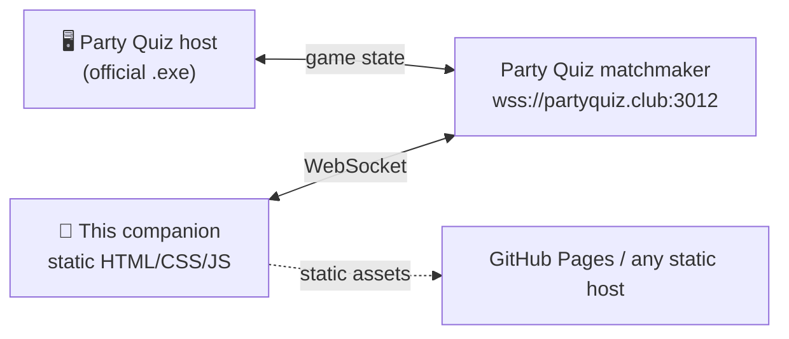

<div align="center">


# PQRevamped

**Unofficial, mobile-first companion for [Party Quiz](https://partyquiz.club)** — a static, zero-build web client with a real 3D avatar try-on, 18 languages, an offline shell and a pile of quality-of-life fixes.

[](https://muxira.github.io/PQRevamped/)
[](#-quick-start)
[](#-languages)

[](https://github.com/muxira/PQRevamped/actions/workflows/ci.yml)
[](LICENSE)
[](CHANGELOG.md)
[](CONTRIBUTING.md)

<sub>English · <a href="README.ru.md">Русский</a></sub>

<br/>
<br/>


</div>

---

## 📖 What is this?

[Party Quiz](https://partyquiz.club) is a Jackbox-style party game: the host runs the game on a PC, everyone else joins from a phone browser. The official companion is a small static bundle — HTML, CSS, vanilla JS and a WebSocket to the matchmaker.

**PQRevamped** is that bundle, re-packed so it can be hosted anywhere (GitHub Pages, Netlify, a Raspberry Pi in the kitchen), with the parts that matter on an actual phone fixed and extended. It talks to the real game — it is not a clone, and nothing here is a cheat: your score still depends on you knowing who invented the sandwich.



---

## ✨ Highlights

| | Feature | What it actually does |
|---|---|---|
| 🧊 | **3D avatar try-on** | See your uploaded drawing wrapped around the real body mesh before you confirm. Orbit, pinch-zoom, reset. Loads Three.js only when you open the tab. |
| 🌍 | **18 languages, switched live** | No reload — so changing language mid-round no longer disconnects you and gets counted as a *pass*. |
| ⚙️ | **Settings sheet** | Language, appearance (auto / light / dark), haptic feedback, keep-screen-awake. Swipe down or press Back to close. |
| 📱 | **Phone-first ergonomics** | Safe-area insets, dynamic viewport height, a bottom bar that steps out of the keyboard's way, thumb-sized controls, pinch-zoom re-enabled and a compact landscape layout. |
| 📲 | **Installable PWA** | Manifest, maskable icons, service worker that pre-caches the shell — the second launch is instant even on a flaky party Wi-Fi. |
| 🛡️ | **"Leave game?" confirmation** | Closing or reloading during a round now asks first, so a stray thumb no longer drops you out of a live game. |
| ♻️ | **Session recovery** | If the tab *was* killed, the resume screen can ask the matchmaker for your seat back instead of only offering *Leave*. |
| 🏁 | **A leaderboard that stays** | Round results and the end-of-game table were painted for a single frame (or not at all); both now hold the screen, medals included. |
| 🖼️ | **Avatars that always draw** | The circle next to a nickname shows initials at once and swaps in the picture when it arrives — a slow or 404 image no longer leaves a hole. |
| 🔁 | **Remembers your last game** | The join screen is pre-filled with the last game ID you used. |
| 🧹 | **Cleaned-up fork** | Dead vendor files, the duplicate asset copy and the stale config shim are gone; every path is checked in CI. |

---

## 📸 Screens

| Landing | Join | Lobby | Answer |
|:---:|:---:|:---:|:---:|
|  |  |  |  |

| Round result | Final leaderboard | Settings | Session recovery |
|:---:|:---:|:---:|:---:|
|  |  |  |  |

<sub>**Rendered previews, not live captures.** This repo has no build step and no browser in CI, so `scripts/render-previews.py` draws every screen with Pillow from the app's own design tokens (`pq-tokens.css`), its own font, avatar PNGs and markup order. Colours, spacing and copy match the shipped screens; live data, animation and the 3D canvas are the parts a still image cannot carry.</sub>

---

## 🚀 Quick start

### Use the hosted build

**→ [muxira.github.io/PQRevamped](https://muxira.github.io/PQRevamped/)** — pick a language, hit Start, enter the game ID from the host screen.

### Run it locally

No build step, no `node_modules`, no toolchain. Any static server works:

```bash
git clone https://github.com/muxira/PQRevamped.git
cd PQRevamped
python3 scripts/preview.py          # http://localhost:8000
```

<details>
<summary>Other ways to serve it</summary>

```bash
python3 -m http.server 8000         # vanilla, also fine
npx serve .                         # Node
php -S localhost:8000               # PHP
```

Open <http://localhost:8000/core/templates/game.html> (the root `index.html` is a language picker that forwards there).
</details>

### Test it on a real phone

A desktop window resized to 375 px is not a phone. Same Wi-Fi, 30 seconds:

```bash
python3 scripts/preview.py --lan
# phone → http://<your-lan-ip>:8000/core/templates/game.html
```

> 🧊 The 3D tab also needs WebGL. On a LAN IP some browsers treat the page as a non-secure context; use `localhost` with port-forwarding, a tunnel, or the hosted HTTPS build if the tab refuses to start.

---

## 🧊 3D Try-On

The reason this fork exists. Upstream lets you pan / zoom / rotate a flat canvas of your uploaded avatar; that preview crops to a face oval, so `TilingX` / `TilingY` repetition and offset drift stay invisible until you are already in-game with a strange-looking body.

The 3D tab renders `assets/models/Body.obj` (the reference mesh) with the **same payload** the game uses:

```
effectiveScale   = Scale * 1.5          // mirrors avatars.js PREVIEW_BASE_ZOOM
texture.repeat   = Tiling / effectiveScale
texture.offset   = (OffsetX, OffsetY)
texture.rotation = Rotation             // centred on (0.5, 0.5)
texture.flipY    = true                 // Unity V-axis; flip if a test image is upside down
```

The fragment shader reproduces Unity's `Custom/AlbedoTiling` vertex projection (`rotate(vUv.yx + offset.yx - .5, rotation) / Scale * Tiling + .5`), which is why the preview matches the in-game body instead of merely looking plausible.

Under the hood, and why it behaves on a phone:

- **Lazy** — `three@0.160.0` (~600 KB) is dynamically imported the first time you open the tab, never on page load;
- **On demand** — frames are rendered when the camera or texture changes, not in a permanent `requestAnimationFrame` loop, so the phone does not cook itself in a modal;
- **Capped DPR** — pixel ratio is clamped to 2;
- **Gesture-safe** — one finger orbits, two fingers pinch, `touch-action: none` keeps the page still, and the canvas stops rendering while the modal is closed;
- **Graceful** — no WebGL, blocked CDN or a missing model each degrade to a clear message (and a procedural placeholder body) instead of a blank circle.

---

## 🌍 Languages

Arabic · Čeština · Deutsch · English · Español (España) · Español (LatAm) · Français · Italiano · Қазақша · 한국어 · Polski · Português · Русский · Svenska · Türkçe · Українська · 简体中文 · 日本語

- Switch **in-game, without a reload** — the WebSocket stays up, the round keeps going.
- Open the settings sheet, or use `?lang=russian`; the choice is stored in `localStorage` under `pq_lang`.
- English is always merged underneath the active dictionary, so an untranslated key renders as English rather than as `bonus_pick_question`.
- RTL is handled (`dir="rtl"` for Arabic); `<html lang>` is set for correct screen-reader pronunciation and CJK glyphs.

---

## 📱 Mobile support

The companion is used while holding a drink in the other hand, so the phone is the primary target:

- `viewport-fit=cover` + `env(safe-area-inset-*)` — nothing hides under the notch or the home indicator;
- `100dvh` and a live `--pq-vvh` variable — the collapsing address bar no longer pushes the bottom bar off screen;
- visual-viewport tracking — the camera/emoji bar steps out of the keyboard's way;
- 16 px minimum input font — iOS does not zoom the page when you focus an answer field;
- pinch-zoom is allowed again (upstream locked the scale) while `touch-action: manipulation` keeps double-tap zoom away from buttons;
- compact header, modal and 3D viewport in short landscape;
- haptics are gated by a setting (`navigator.vibrate`, so Android only — iOS has no API for it).

---

## 📦 Upstream parity

Synced with the live client on **2026-10-20**. Everything the official companion does is here, including the newer systems:

| Upstream feature | Status |
|---|---|
| Lobby, teams, captain suggestions, role picker | ✅ |
| Questions, auction, cat-in-a-poke, final round, number guess, multiple choice | ✅ |
| **Bonus system** — tray, lootbox reel, hint / joker / shield / x-ray / pick-a-victim | ✅ `bonus.js`, `bonus-lootbox.js`, `pq-bonus.css` |
| **Appeals** — "I'm right", voting, timers, results | ✅ |
| **Returning players** — profile inheritance prompt and approval flow | ✅ |
| **Fast-forward** — hold to speed up, deputy fast-forward | ✅ |
| **Manage players** — kick, ± points with a step input | ✅ |
| Themes (`studio` / `night`), reconnect screen, system notices | ✅ |
| 18 locale dictionaries, self-hosted `party-quiz-sans` fonts | ✅ |

Known upstream quirks this fork changes on purpose: the socket host (see [URL parameters](#-url-parameters)), the language switch (no reload), and the leave button (asks first).

---

## 🗂️ Project structure

```
.
├── index.html                     # language picker → core/templates/game.html
├── manifest.webmanifest           # PWA metadata
├── sw.js                          # offline shell (network-first pages, SWR assets)
├── core/
│   ├── assets/                    # canvas-safe copies used by the client
│   └── templates/
│       ├── game.html              # the companion
│       ├── css/                   # upstream 12 stylesheets + pq-revamped.css
│       └── js/                    # upstream 10 scripts + revamped.js + custom_avatar_3d.js
├── assets/                        # logo, fonts (woff2+ttf), sprites, icons, Body.obj
├── avatars/                       # 26 stock avatar illustrations
├── localized/<locale>/lang.json   # 18 dictionaries, 296 keys each
├── docs/screenshots/              # README previews, drawn by scripts/render-previews.py
├── scripts/                       # preview · check · i18n sync · upstream fetch · previews
└── .github/workflows/             # CI (checks) + Pages (deploy gate)
```

Files this fork adds on top of upstream are listed in [`CHANGELOG.md`](CHANGELOG.md); everything else is upstream code, kept as close to the original as possible so the next sync stays a diff, not a rewrite.

---

## 🛠️ Development

```bash
python3 scripts/preview.py           # serve with correct MIME types + no-cache
python3 scripts/preview.py --lan     # ...and bind 0.0.0.0 for a phone
python3 scripts/check.py             # references, i18n keys, JSON, leftovers
python3 scripts/sync-i18n.py         # audit dictionaries (--scrape: pull new keys)
python3 scripts/fetch-upstream.py    # mirror the live client into _upstream/ for a diff
python3 scripts/render-previews.py   # redraw docs/screenshots/*.png (needs Pillow)
```

`scripts/check.py` runs in CI on every push and before every Pages deploy, so a typo in a stylesheet path fails the build instead of shipping a page with no CSS. CI also runs `node --check` over every script and verifies that all 18 dictionaries carry the same key set.

**Syncing upstream** (how this repo stays current):

```bash
python3 scripts/fetch-upstream.py --out _upstream
diff -ru _upstream/core/templates core/templates     # review, then port by hand
python3 scripts/sync-i18n.py --scrape                # pick up new keys
python3 scripts/check.py
```

The fork deliberately keeps its own additions in **three places only** — `js/revamped.js`, `js/custom_avatar_3d.js`, `css/pq-revamped.css` — plus small, marked patches in `game.html`, `i18n.js` and `main.js`. Anything else stays byte-identical to upstream.

---

## 🔗 URL parameters

| Parameter | Example | Effect |
|---|---|---|
| `lang` | `?lang=ukrainian` | Start in a specific locale |
| `game` | `?game=AB12CD` | Pre-fill (and auto-join) a game — this is what QR codes use |
| `server` | `?server=stage.partyquiz.club` | Point the socket at a non-default matchmaker (allow-listed hosts only) |
| `settings=1` | `?settings=1` | Open the settings sheet on load |
| `nosw=1` | `?nosw=1` | Skip service-worker registration (and unregister an existing one) |
| `bot=1` | `?bot=1` | Isolate storage in `sessionStorage` for scripted test windows |

> **Socket host:** on a foreign origin (GitHub Pages, `file://`, a LAN IP) the client always connects to `wss://partyquiz.club:3012` instead of `wss://<page-host>:3012`. Upstream built the URL from `location.hostname`, which never resolves on a static host and left the connection dot blinking forever.

---

## 🌐 Deploying

**GitHub Pages (included).** Push to `master`; `.github/workflows/pages.yml` runs `scripts/check.py` and publishes the repo root. For a manual setup: *Settings → Pages → Deploy from branch → `master` / root*.

**Anywhere else.** It is a folder of static files:

```bash
# Netlify / Vercel / Cloudflare Pages
build command: (none)      output directory: /
```

Everything uses relative paths, so a project sub-path (`/PQRevamped/`) works without configuration.

---

## ❓ FAQ

<details>
<summary><b>The connection dot stays orange / "host is not connected".</b></summary>

The companion talks to the real matchmaker; there must be a host running the official game with that ID. Check that the ID is right, then reload — or use the refresh button in the header.
</details>

<details>
<summary><b>The 3D tab is missing.</b></summary>

No WebGL (an old browser, a locked-down webview, a GPU-blocklisted device) or the Three.js CDN is unreachable. The tab hides itself and the flat editor keeps working.
</details>

<details>
<summary><b>My avatar looks upside down in 3D.</b></summary>

Flip `TEXTURE_FLIP_Y` at the top of `core/templates/js/custom_avatar_3d.js` and open a PR with a screenshot — that constant is a one-time calibration against the Unity V-axis.
</details>

<details>
<summary><b>Why does the first load pull files from partyquiz.club?</b></summary>

Only the WebSocket does. Every static asset (fonts, avatars, dictionaries, logo) is served from this repo so the client works on a static host without CORS surprises.
</details>

<details>
<summary><b>Is this cheating / does it change the rules?</b></summary>

No. It is the same client, same protocol, same host authority. The additions are view-layer and ergonomics; nothing inspects answers or fakes scores.
</details>

---

## ⚖️ Legal & credits

- **License:** [MIT](LICENSE) © 2026 muxira (Artem Muzyra).
- **Not affiliated** with Party Quiz or its developers. "Party Quiz" and its logo belong to their authors; the assets in this repository are the ones a browser downloads from the public client, included so the companion can run as a static site.
- **`assets/models/Body.obj`** is a reference mesh used only for the preview. If you plan to redistribute this fork commercially, re-check that you have the right to ship it — otherwise disable the 3D tab (or swap in your own mesh) before publishing.
- **README previews** are drawn by [`scripts/render-previews.py`](scripts/render-previews.py); the emoji artwork they contain (👏 and the medals) is Noto Color Emoji under Apache-2.0 — see [`docs/screenshots/emoji/`](docs/screenshots/emoji/).
- **Please be gentle** with the official infrastructure: this is fine for personal / friends-and-family use, not for load testing or automation.
- Thanks to the Party Quiz team for a web client that is small enough to read in an evening.

<div align="center">
<sub>Built for the moment the host says “phones out”.</sub>
</div>
