<div align="center">

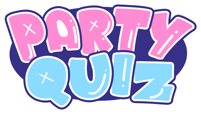

# PQRevamped

**Неофициальный мобильный компаньон для [Party Quiz](https://partyquiz.club)** — статический клиент без сборки: настоящее 3D-превью аватара, 18 языков, офлайн-оболочка и куча QoL-исправлений.

[](https://muxira.github.io/PQRevamped/)
[](#-быстрый-старт)
[](#-языки)

[](https://github.com/muxira/PQRevamped/actions/workflows/ci.yml)
[](LICENSE)
[](CHANGELOG.md)

<sub><a href="README.md">English</a> · Русский</sub>

<br/>
<br/>

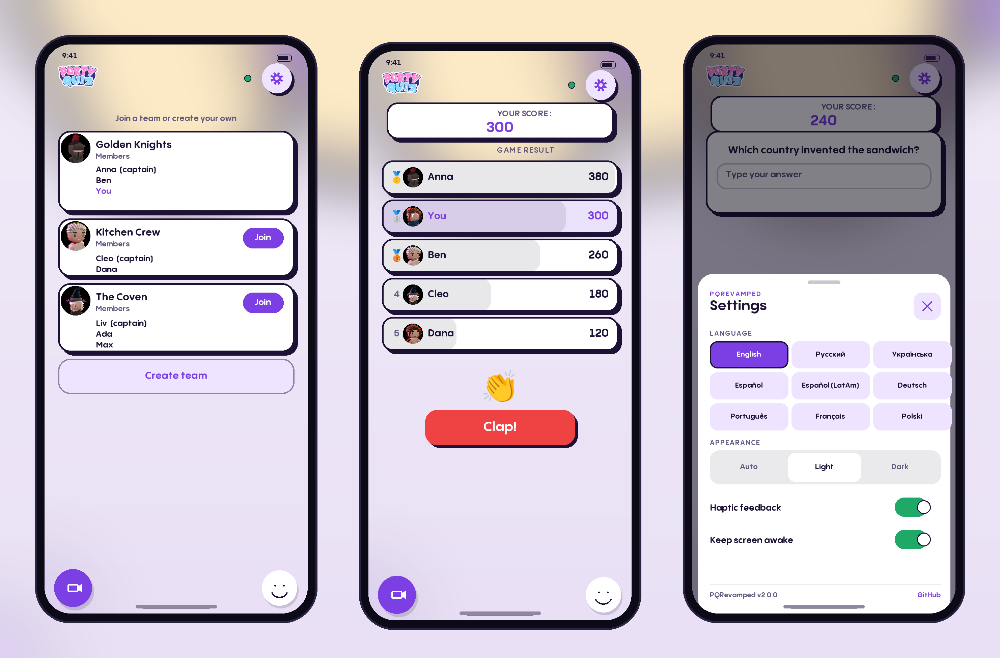

</div>

---

## 📖 Что это

[Party Quiz](https://partyquiz.club) — вечериночная викторина в духе Jackbox: ведущий запускает игру на ПК, остальные подключаются с телефона через браузер. Официальный веб-клиент — это небольшая статическая сборка: HTML, CSS, ванильный JS и WebSocket до матчмейкера.

**PQRevamped** — та же сборка, перепакованная так, чтобы её можно было хостить где угодно (GitHub Pages, Netlify, Raspberry Pi на кухне), с исправленным и расширенным тем, что реально важно на телефоне. Это не клон игры и не читы: счёт по-прежнему зависит от того, помните ли вы, кто придумал сэндвич.

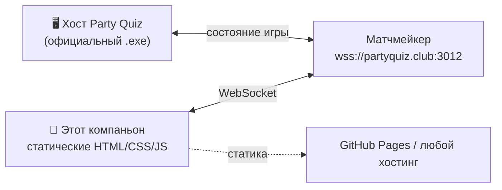

---

## ✨ Возможности

| | Что | Как это работает |
|---|---|---|
| 🧊 | **3D-превью аватара** | Своя картинка натягивается на настоящую модель тела ещё до подтверждения. Вращение, пинч-зум, сброс. Three.js грузится только при открытии вкладки. |
| 🌍 | **18 языков без перезагрузки** | Смена языка посреди раунда больше не рвёт WebSocket и не засчитывается как *пас*. |
| ⚙️ | **Шторка настроек** | Язык, тема (авто / светлая / тёмная), вибрация, «не гасить экран». Закрывается свайпом вниз или кнопкой «Назад». |
| 📱 | **Эргономика телефона** | Safe-area, динамическая высота вьюпорта, нижняя панель уезжает от клавиатуры, крупные тап-зоны, пинч-зум и компактный ландшафт. |
| 📲 | **PWA** | Манифест, maskable-иконки, service worker с кэшем оболочки — второй запуск мгновенный даже на плохом Wi-Fi. |
| 🛡️ | **Подтверждение выхода** | Закрытие или перезагрузка посреди раунда теперь спрашивает подтверждение — случайный палец больше не выкидывает из игры. |
| ♻️ | **Восстановление сессии** | Если вкладку всё-таки убили, экран возврата умеет заново занять место в игре, а не только предлагает «Выйти». |
| 🏁 | **Таблица, которая не исчезает** | Результаты раунда и итоговая таблица показывались на один кадр (или не показывались вовсе) — теперь они держатся на экране, с медалями. |
| 🖼️ | **Аватар всегда на месте** | Кружок у ника сразу показывает инициалы и подменяет их картинкой, когда она догрузилась: медленный или битый файл больше не оставляет дырку. |
| 🔁 | **Помнит последнюю игру** | Поле ID на экране входа уже заполнено. |
| 🧹 | **Чистый форк** | Удалены мёртвые вендорные файлы, дубли ассетов и устаревший конфиг; все пути проверяются в CI. |

---

## 📸 Скриншоты

| Выбор языка | Вход в игру | Лобби | Ответ |
|:---:|:---:|:---:|:---:|
| 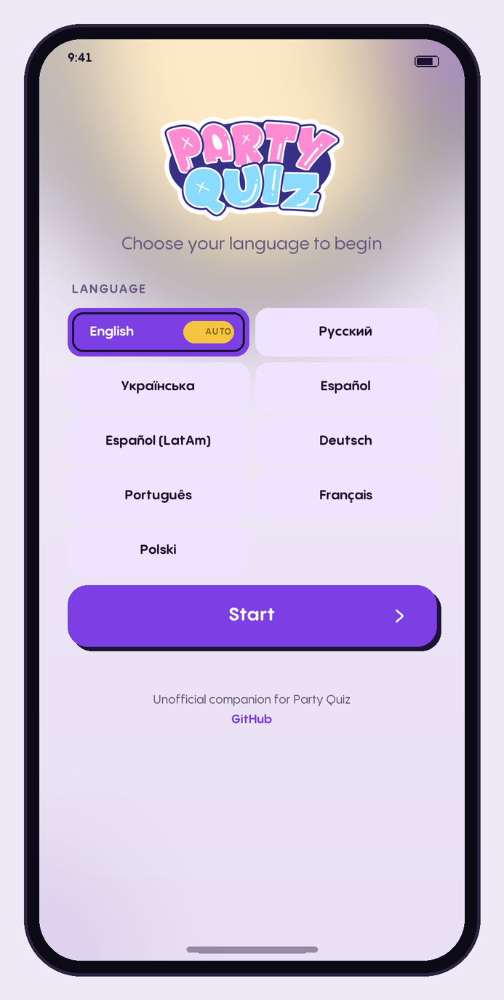 | 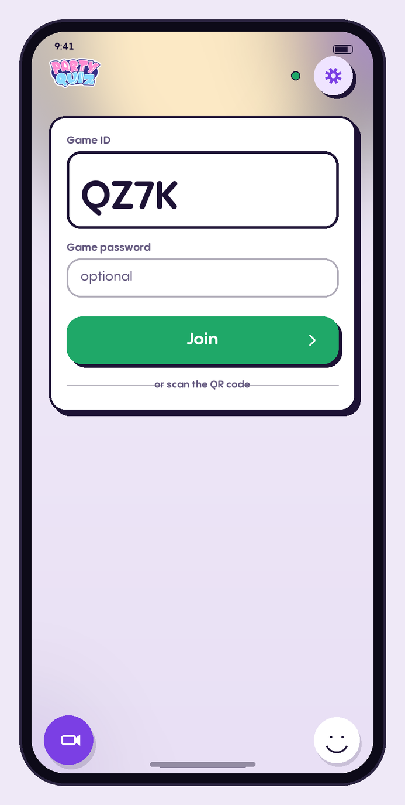 | 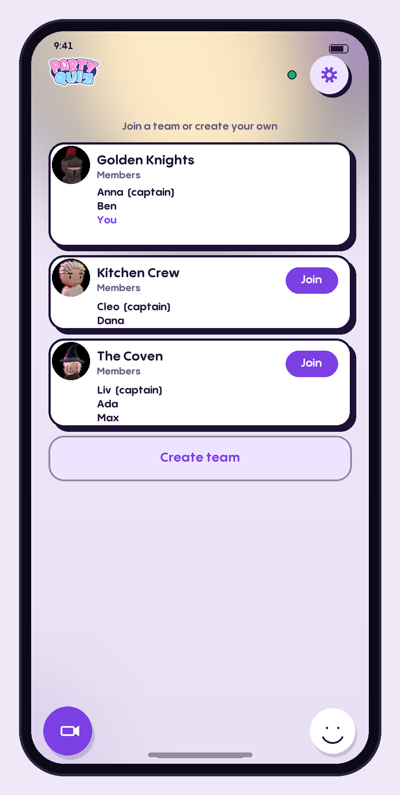 | 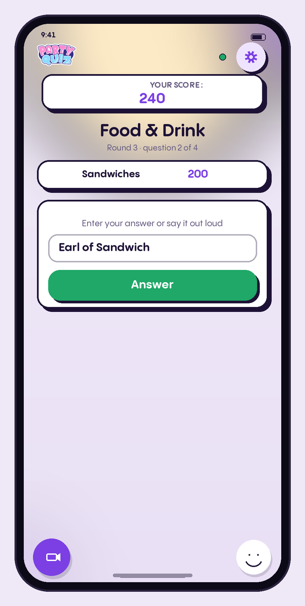 |

| Результат раунда | Итоговая таблица | Настройки | Возврат в игру |
|:---:|:---:|:---:|:---:|
| 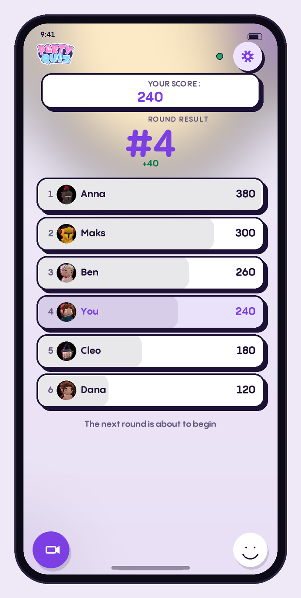 | 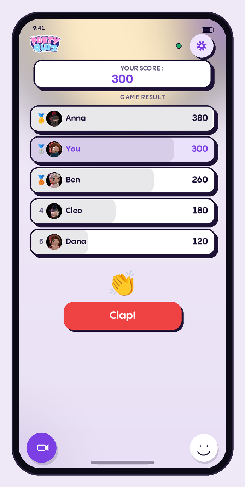 | 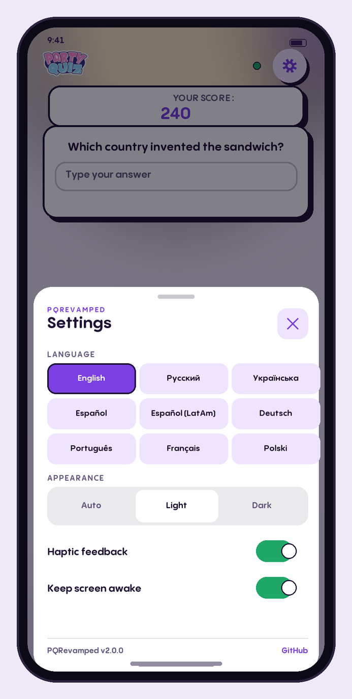 | 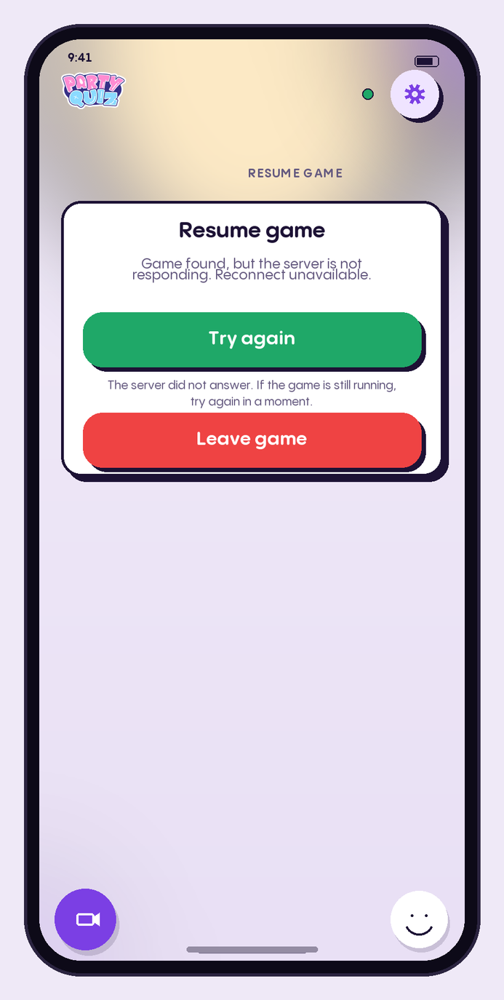 |

<sub>**Это отрендеренные превью, а не живые скриншоты.** В репозитории нет сборки и нет браузера в CI, поэтому `scripts/render-previews.py` рисует каждый экран через Pillow из тех же токенов дизайна (`pq-tokens.css`), того же шрифта, тех же PNG-аватаров и того же порядка разметки. Цвета, отступы и тексты совпадают с тем, что отдаёт сайт; живая игра, анимации и 3D-сцена — это то, что статичная картинка передать не может.</sub>

---

## 🚀 Быстрый старт

### Готовая сборка

**→ [muxira.github.io/PQRevamped](https://muxira.github.io/PQRevamped/)** — выберите язык, нажмите «Начать», введите ID игры с экрана ведущего.

### Локально

Ни сборки, ни `node_modules`, ни тулчейна:

```bash
git clone https://github.com/muxira/PQRevamped.git
cd PQRevamped
python3 scripts/preview.py          # http://localhost:8000
```

Подойдёт и обычный `python3 -m http.server 8000`, `npx serve .`, `php -S localhost:8000`. Открывать нужно `core/templates/game.html` — корневой `index.html` просто перенаправляет туда, выбрав язык.

### Проверка на настоящем телефоне

Окно браузера шириной 375 px — это не телефон. В той же Wi-Fi:

```bash
python3 scripts/preview.py --lan
# на телефоне → http://<lan-ip>:8000/core/templates/game.html
```

> 🧊 Для 3D-вкладки нужен WebGL. По LAN-IP браузер может считать страницу небезопасным контекстом — используйте `localhost` с пробросом портов, туннель или HTTPS-сборку.

---

## 🧊 3D-превью

Главная причина существования форка. Оригинал даёт плоский холст с пан/зумом/поворотом, обрезанный овалом лица, поэтому повторение текстуры (`TilingX` / `TilingY`) и смещение видны только уже в игре — на кривом теле.

Вкладка 3D рендерит `assets/models/Body.obj` с тем же payload, что использует игра:

```
effectiveScale   = Scale * 1.5          // как PREVIEW_BASE_ZOOM в avatars.js
texture.repeat   = Tiling / effectiveScale
texture.offset   = (OffsetX, OffsetY)
texture.rotation = Rotation             // центр (0.5, 0.5)
texture.flipY    = true                 // ось V Unity; переверните, если картинка вверх ногами
```

Фрагментный шейдер повторяет проекцию Unity `Custom/AlbedoTiling`, поэтому превью совпадает с телом в игре, а не «выглядит правдоподобно».

Почему это работает на телефоне:

- **Ленивая загрузка** — `three@0.160.0` (~600 КБ) подтягивается при первом открытии вкладки;
- **Рендер по требованию** — кадр рисуется при изменении камеры/текстуры, а не в вечном `requestAnimationFrame`;
- **Ограниченный DPR** — pixel ratio не выше 2;
- **Жесты** — один палец вращает, два масштабируют, `touch-action: none` не даёт странице скроллиться;
- **Деградация** — нет WebGL, CDN заблокирован или модель не загрузилась → понятное сообщение и процедурный «манекен» вместо пустого круга.

---

## 🌍 Языки

العربية · Čeština · Deutsch · English · Español (España) · Español (LatAm) · Français · Italiano · Қазақша · 한국어 · Polski · Português · Русский · Svenska · Türkçe · Українська · 简体中文 · 日本語

- Переключение **в игре, без перезагрузки** — WebSocket жив, раунд продолжается.
- Через шторку настроек или `?lang=russian`; выбор хранится в `localStorage` (`pq_lang`).
- Английский словарь всегда подмешивается снизу: непереведённый ключ показывается по-английски, а не как `bonus_pick_question`.
- Поддержан RTL (арабский), выставляется `<html lang>` — корректное произношение скринридером и формы глифов CJK.

---

## 📱 Мобильная поддержка

- `viewport-fit=cover` + `env(safe-area-inset-*)` — ничего не прячется под «монобровью» и полосой жестов;
- `100dvh` и живая переменная `--pq-vvh` — схлопывание адресной строки больше не выдавливает нижнюю панель;
- отслеживание visual viewport — панель камеры/эмодзи уезжает от клавиатуры;
- минимальный шрифт полей 16 px — iOS не зумит страницу при фокусе;
- пинч-зум снова разрешён (оригинал его запрещал), при этом `touch-action: manipulation` убирает двойной тап-зум по кнопкам;
- компактные хедер, модалка и 3D в коротком ландшафте;
- вибрация отключается в настройках (`navigator.vibrate`, только Android — в iOS API нет).

---

## 📦 Соответствие апстриму

Синхронизировано с живым клиентом **20.10.2026**. Всё, что умеет официальный компаньон, есть и здесь, включая новые системы:

| Возможность апстрима | Статус |
|---|---|
| Лобби, команды, подсказки капитану, выбор роли | ✅ |
| Вопросы, аукцион, «кот в мешке», финал, угадай число, мультивыбор | ✅ |
| **Бонусы** — лоток, лутбокс, подсказка / джокер / щит / рентген / выбор жертвы | ✅ `bonus.js`, `bonus-lootbox.js`, `pq-bonus.css` |
| **Апелляции** — «я прав», голосование, таймеры | ✅ |
| **Возвращение игроков** — наследование профиля и подтверждение | ✅ |
| **Перемотка** — удержание, режим зама | ✅ |
| **Управление игроками** — кик, ± очки с шагом | ✅ |
| Темы (`studio` / `night`), реконнект, системные уведомления | ✅ |
| 18 словарей, свои шрифты `party-quiz-sans` | ✅ |

Осознанные отличия: адрес сокета (см. [параметры URL](#-параметры-url)), смена языка без перезагрузки и подтверждение выхода.

---

## 🗂️ Структура

```
.
├── index.html                     # выбор языка → core/templates/game.html
├── manifest.webmanifest           # метаданные PWA
├── sw.js                          # офлайн-оболочка
├── core/
│   ├── assets/                    # копии, безопасные для canvas
│   └── templates/
│       ├── game.html              # сам компаньон
│       ├── css/                   # 12 стилей апстрима + pq-revamped.css
│       └── js/                    # 10 скриптов апстрима + revamped.js + custom_avatar_3d.js
├── assets/                        # логотип, шрифты (woff2+ttf), спрайты, иконки, Body.obj
├── avatars/                       # 26 стоковых аватаров
├── localized/<locale>/lang.json   # 18 словарей по 296 ключей
├── docs/screenshots/              # превью для README, рисуются scripts/render-previews.py
├── scripts/                       # preview · check · sync-i18n · fetch-upstream · превью
└── .github/workflows/             # CI (проверки) + Pages (деплой с гейтом)
```

Что именно добавлено поверх апстрима — в [`CHANGELOG.md`](CHANGELOG.md). Всё остальное — код апстрима, максимально близкий к оригиналу, чтобы следующая синхронизация оставалась диффом, а не переписыванием.

---

## 🛠️ Разработка

```bash
python3 scripts/preview.py           # сервер с правильными MIME и без кэша
python3 scripts/preview.py --lan     # ...и на 0.0.0.0, чтобы зайти с телефона
python3 scripts/check.py             # ссылки, ключи i18n, JSON, мусор
python3 scripts/sync-i18n.py         # аудит словарей (--scrape — подтянуть новые ключи)
python3 scripts/fetch-upstream.py    # зеркало живого клиента в _upstream/ для диффа
python3 scripts/render-previews.py   # перерисовать docs/screenshots/*.png (нужен Pillow)
```

`scripts/check.py` запускается в CI на каждый пуш и перед каждым деплоем Pages: опечатка в пути к стилю ломает сборку, а не отдаёт игрокам страницу без CSS. CI также прогоняет `node --check` по всем скриптам и сверяет наборы ключей во всех 18 словарях.

**Синхронизация с апстримом:**

```bash
python3 scripts/fetch-upstream.py --out _upstream
diff -ru _upstream/core/templates core/templates     # ревью, затем перенос руками
python3 scripts/sync-i18n.py --scrape                # новые ключи
python3 scripts/check.py
```

Форк держит свои добавления **в трёх местах** — `js/revamped.js`, `js/custom_avatar_3d.js`, `css/pq-revamped.css` — плюс небольшие помеченные патчи в `game.html`, `i18n.js` и `main.js`. Всё остальное побайтово совпадает с апстримом.

---

## 🔗 Параметры URL

| Параметр | Пример | Действие |
|---|---|---|
| `lang` | `?lang=ukrainian` | Стартовать на выбранном языке |
| `game` | `?game=AB12CD` | Подставить (и автоматически ввести) ID игры — так работают QR-коды |
| `server` | `?server=stage.partyquiz.club` | Другой матчмейкер (только из белого списка) |
| `settings=1` | `?settings=1` | Открыть настройки при загрузке |
| `nosw=1` | `?nosw=1` | Не регистрировать service worker (и снять существующий) |
| `bot=1` | `?bot=1` | Хранить состояние в `sessionStorage` для тестовых окон |

> **Адрес сокета:** на чужом origin (GitHub Pages, `file://`, LAN-IP) клиент всегда подключается к `wss://partyquiz.club:3012`, а не к `wss://<хост-страницы>:3012`. Апстрим строил адрес из `location.hostname`, что на статическом хостинге не резолвится и оставляет индикатор вечно оранжевым.

---

## 🌐 Деплой

**GitHub Pages (уже настроен).** Пуш в `main` → `.github/workflows/pages.yml` прогоняет `scripts/check.py` и публикует корень репозитория. Вручную: *Settings → Pages → Deploy from branch → `main` / root*.

**Куда угодно ещё.** Это просто папка статики: команда сборки не нужна, каталог публикации — `/`. Все пути относительные, поэтому подкаталог (`/PQRevamped/`) работает без настроек.

---

## ❓ FAQ

<details>
<summary><b>Индикатор подключения оранжевый / «хост не подключён».</b></summary>

Компаньон общается с настоящим матчмейкером: должен быть запущен официальный хост с этим ID. Проверьте ID и перезагрузите страницу кнопкой в хедере.
</details>

<details>
<summary><b>Нет вкладки 3D.</b></summary>

Нет WebGL (старый браузер, урезанный webview, GPU в блок-листе) или недоступен CDN Three.js. Вкладка скрывается, плоский редактор продолжает работать.
</details>

<details>
<summary><b>Аватар в 3D вверх ногами.</b></summary>

Переверните `TEXTURE_FLIP_Y` в начале `core/templates/js/custom_avatar_3d.js` и пришлите PR со скриншотом — это разовая калибровка оси V относительно Unity.
</details>

<details>
<summary><b>Почему при первой загрузке что-то тянется с partyquiz.club?</b></summary>

Только WebSocket. Все статические файлы (шрифты, аватары, словари, логотип) отдаются из этого репозитория, чтобы клиент работал на статическом хостинге без сюрпризов CORS.
</details>

<details>
<summary><b>Это читы? Меняет ли форк правила?</b></summary>

Нет. Тот же клиент, тот же протокол, решения всё так же принимает хост. Все изменения — слой представления и эргономика: код не подглядывает ответы и не подделывает счёт.
</details>

---

## ⚖️ Лицензия и благодарности

- **Лицензия:** [MIT](LICENSE) © 2026 muxira (Artem Muzyra).
- **Не связан** с Party Quiz и её разработчиками. «Party Quiz» и логотип принадлежат авторам; ассеты в репозитории — те, что браузер скачивает с публичного клиента, добавлены, чтобы компаньон работал как статический сайт.
- **`assets/models/Body.obj`** — референсная модель только для превью. Если планируете распространять форк коммерчески, перепроверьте право на её публикацию — иначе отключите 3D-вкладку или замените модель перед публикацией.
- **Превью в README** рисует [`scripts/render-previews.py`](scripts/render-previews.py); эмодзи в них (👏 и медали) — Noto Color Emoji под Apache-2.0, см. [`docs/screenshots/emoji/`](docs/screenshots/emoji/).
- **Берегите инфраструктуру**: персональное использование с друзьями — да, нагрузочные тесты и автоматизация — нет.
- Спасибо команде Party Quiz за веб-клиент, который можно прочитать за вечер.

<div align="center">
<sub>Сделано для момента, когда ведущий говорит «достаём телефоны».</sub>
</div>
